<div align="center">

<a href="https://webloom-nu.vercel.app">
  
</a>

<br /><br />

<a href="https://webloom-nu.vercel.app">
  
</a>
&nbsp;
<a href="https://github.com/AnonymusAgent?tab=repositories">
  
</a>
&nbsp;
<a href="mailto:webloomofficial@gmail.com">
  
</a>

<br /><br />

> **I'm Ali Mukhtar (`@AnonymusAgent`)**, founder & full-stack developer at **Web Loom**.
> I architect and ship production web platforms, enterprise dashboards, media & OCR engines, and cross-platform mobile apps — taking products from **system design → PostgreSQL schema → TypeScript engineering → verified production launch**.

</div>

---

## `01` · 3D Architecture & Codebase Telemetry

<div align="center">
  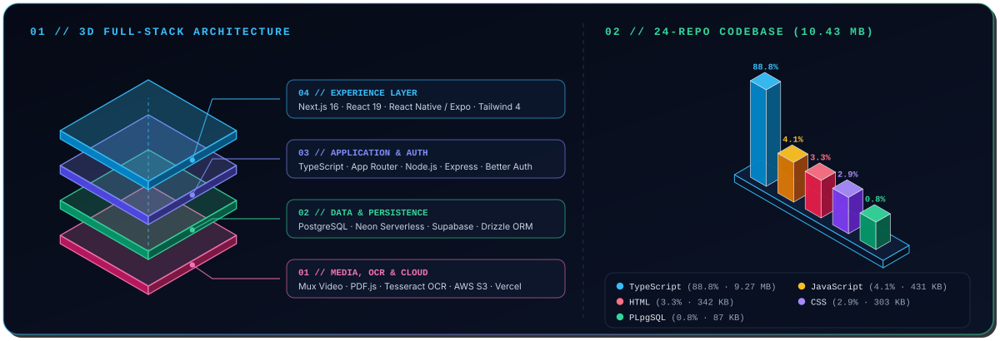
</div>

---

## `02` · 3D Flagship Showcase

<table>
  <tr>
    <td width="50%" align="center" valign="top">
      <a href="https://github.com/AnonymusAgent/Webloom">
        
      </a>
      <br />
      <a href="https://github.com/AnonymusAgent/Webloom"><code>Repository →</code></a>
      &nbsp;·&nbsp;
      <a href="https://webloom-nu.vercel.app"><code>Live Demo ↗</code></a>
    </td>
    <td width="50%" align="center" valign="top">
      <a href="https://github.com/AnonymusAgent/Bloom-AR">
        
      </a>
      <br />
      <a href="https://github.com/AnonymusAgent/Bloom-AR"><code>Repository →</code></a>
      &nbsp;·&nbsp;
      <a href="https://ar-manager-ten.vercel.app"><code>Live Demo ↗</code></a>
    </td>
  </tr>
  <tr>
    <td width="50%" align="center" valign="top">
      <a href="https://github.com/AnonymusAgent/VELTRIO">
        
      </a>
      <br />
      <a href="https://github.com/AnonymusAgent/VELTRIO"><code>Repository →</code></a>
      &nbsp;·&nbsp;
      <a href="https://video-hub-hazel.vercel.app"><code>Live Demo ↗</code></a>
    </td>
    <td width="50%" align="center" valign="top">
      <a href="https://github.com/AnonymusAgent/pdfpro">
        
      </a>
      <br />
      <a href="https://github.com/AnonymusAgent/pdfpro"><code>Repository →</code></a>
      &nbsp;·&nbsp;
      <a href="https://pdfpro-pearl.vercel.app"><code>Live Demo ↗</code></a>
    </td>
  </tr>
  <tr>
    <td width="50%" align="center" valign="top">
      <a href="https://github.com/AnonymusAgent/type-arena">
        
      </a>
      <br />
      <a href="https://github.com/AnonymusAgent/type-arena"><code>Repository →</code></a>
      &nbsp;·&nbsp;
      <a href="https://type-arena-silk.vercel.app"><code>Live Demo ↗</code></a>
    </td>
    <td width="50%" align="center" valign="top">
      <a href="https://github.com/AnonymusAgent/bloomrcm">
        
      </a>
      <br />
      <a href="https://github.com/AnonymusAgent/bloomrcm"><code>Repository →</code></a>
      &nbsp;·&nbsp;
      <a href="https://bloomrcm.vercel.app"><code>Live Demo ↗</code></a>
    </td>
  </tr>
  <tr>
    <td width="50%" align="center" valign="top">
      <a href="https://github.com/AnonymusAgent/Noor">
        
      </a>
      <br />
      <a href="https://github.com/AnonymusAgent/Noor"><code>Repository →</code></a>
      &nbsp;·&nbsp;
      <code>Expo · iOS · Android · Web</code>
    </td>
    <td width="50%" align="center" valign="top">
      <a href="https://github.com/AnonymusAgent/BloomAI">
        
      </a>
      <br />
      <a href="https://github.com/AnonymusAgent/BloomAI"><code>Repository →</code></a>
      &nbsp;·&nbsp;
      <code>React 18 · Vite · Supabase</code>
    </td>
  </tr>
</table>

<details>
<summary><b>More Projects Across the 24-Repo Ecosystem</b> — Web Platforms, Mobile Apps & Dashboards</summary>
<br />

| Project | Domain & Focus | Core Stack | Links |
| :--- | :--- | :--- | :--- |
| **ProFix** | Services booking, customer JWT portals & admin console | React 18 · Vite · Express · Neon | [`Repo`](https://github.com/AnonymusAgent/ProFix) |
| **EduPortal Academy** | WCAG 2.2 AA academic portal & admin dashboard | Next.js · TypeScript · Drizzle · PG | [`Repo`](https://github.com/AnonymusAgent/eduportal) |
| **La Maison (`Restaurant-Web`)** | Responsive dining experience & serverless admin analytics | HTML · CSS · JS · Neon Serverless | [`Repo`](https://github.com/AnonymusAgent/Restaurant-Web) · [`Live`](https://lamasion.vercel.app) |
| **ChessMastersArena** | Cross-platform 3D chess mobile experience | Expo · React Native · Supabase | [`Repo`](https://github.com/AnonymusAgent/ChessMastersArena) |
| **Medx** | Mobile health tracking & utility suite (⭐ Starred) | Expo · React Native · Supabase | [`Repo`](https://github.com/AnonymusAgent/Medx) |
| **Device-Health-Suite** | Device battery, sensor & diagnostics utility | Expo · React Query · Drizzle | [`Repo`](https://github.com/AnonymusAgent/Device-Health-Suite) |
| **Wifi-dashboard** | Real-time network telemetry & Wi-Fi dashboard | JavaScript · HTML · CSS | [`Repo`](https://github.com/AnonymusAgent/Wifi-dashboard) |

</details>

---

## `03` · 3D Isometric Contribution Skyline

<div align="center">
  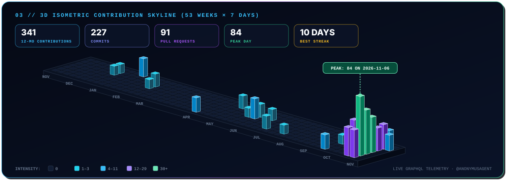
</div>

---

## `04` · Spatial Engineering Pipeline

<div align="center">
  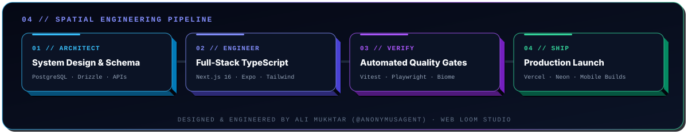

  <br /><br />

  <a href="https://webloom-nu.vercel.app">
    
  </a>
  &nbsp;
  <a href="mailto:webloomofficial@gmail.com">
    
  </a>
</div>

<details>
<summary><sub><b>3D SVG Asset Generator</b> — Refresh all 12 spatial SVGs from live GitHub GraphQL telemetry</sub></summary>

```bash
# Regenerate all 3D SVGs from cached snapshot (data/github_stats.json)
python3 scripts/generate_3d_assets.py

# Refresh live repository languages & 53-week GraphQL contribution skyline via GitHub CLI
python3 scripts/generate_3d_assets.py --refresh
```

</details>
